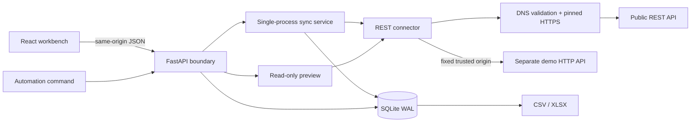
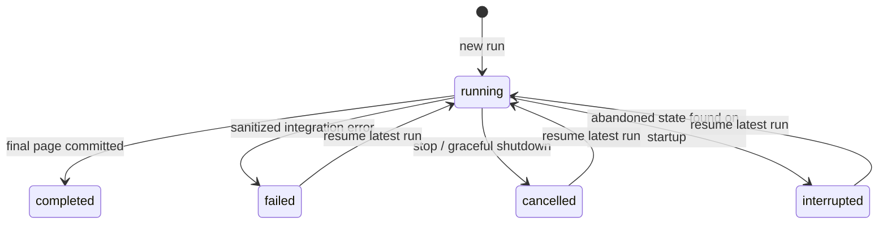

# Architecture and invariants

## Boundaries

- `api.py`: local request boundary, safe validation responses, settings, preview, run commands, records and export. Frontend assets are served from `frontend/dist` if built. There is no CORS middleware.
- `models.py`: validated configuration, dotted-path extraction and pure record normalization. The destination schema is deliberately fixed to five order fields.
- `security.py`: URL policy, all-answer DNS validation and a vetted IP destination. Custom connections preserve Host and TLS SNI while avoiding a second DNS lookup. The separate demo is selected by source type, never by an editable private URL.
- `connector.py`: `Connector` protocol and `RestConnector`. Fetch returns a completely validated `Page` or a sanitized `IntegrationError(code, message, hint)`. It owns HTTP behavior, retry delays, payload limits and envelope parsing. It knows nothing about SQLite.
- `sync.py`: orchestration and transaction boundaries. A configurable connector factory keeps transport adaptation separate from checkpoint logic. One task runs at a time; other starts fail with conflict.
- `storage.py`: SQLite connections, schema creation, read models and startup interruption recovery. Every connection has its own explicit commit/rollback lifecycle and a busy timeout; WAL allows reads during synchronization.
- `demo.py`: a real upstream on a separate socket/process. Failure branches emit actual statuses, bytes, delays and invalid metadata. It contains synthetic business data only.

## Persistent model

| Table | Responsibility |
| --- | --- |
| `settings` | One connection configuration and the last fully successful watermark; no credential column |
| `records` | Canonical mapped JSON keyed by the stable source ID |
| `runs` | Frozen config, original watermark, next-page token, accumulated max timestamp, counters and lifecycle state |
| `fingerprints` | Normalized page hashes per run, preventing repeated-page loops |
| `events` | Bounded-by-run-limits diagnostic history with codes/hints; no raw bodies or identities |

`started`/`ended` timestamps use UTC. All SQL data inputs are bound parameters. Dynamic SQL is limited to a fixed internal list of table names for workspace reset.

## State machine

A SQLite transaction applies a whole page's upserts, its counters, fingerprint and continuation. On the terminal page the same transaction marks completion and writes the watermark. An exception rolls the transaction back. Events are intentionally separate from page commits: a hard kill can leave an event missing, but never a checkpoint/record mismatch. Durable counters remain authoritative.

The task yields between pages, during outbound I/O and backoff. Cancellation cannot split a synchronous page transaction. A process kill leaves status `running`; startup converts that to `interrupted`. Credentials are deliberately not recovered after a restart.

This is at-least-once fetching with idempotent storage, not exactly-once delivery. A process may die after the HTTP response but before the transaction, in which case the same page is fetched again. Exports read committed records and can include partial-run data.

## Deliberate limits

One user, one configured integration, one backend worker and one SQLite file. No migrations are necessary for the initial schema; future schema changes need an explicit version/migration mechanism. There is no promise of multi-process coordination, source snapshot isolation, a durable scheduler or automatic OAuth token refresh. These boundaries keep recovery inspectable and the application runnable without infrastructure.

Use a new connector for different pagination/auth/envelope protocols. Keep `Page` records normalized, continuation opaque, and failures sanitized. The synchronization and persistence invariants then stay unchanged.

## Design references

The implementation follows [HTTPX's timeout model](https://www.python-httpx.org/advanced/timeouts/) and adds a wall deadline to bound a continuously trickling response. HTTP retries live in the connector because [HTTPX transport retries](https://www.python-httpx.org/advanced/transports/) cover connection failures rather than this tool's full 429/5xx policy. FastAPI's [lifespan mechanism](https://fastapi.tiangolo.com/advanced/events/) handles abandoned-run recovery and task cleanup.
